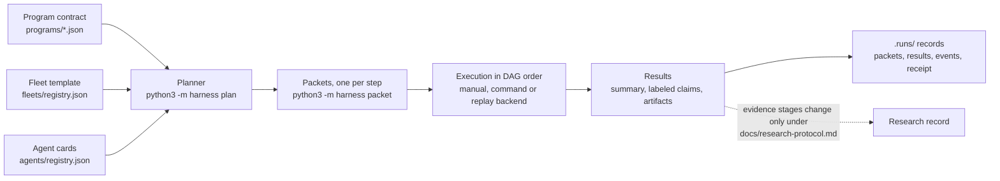
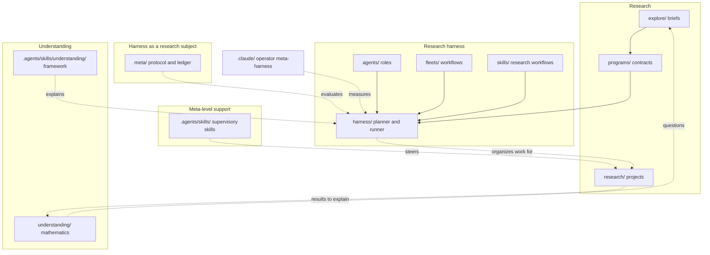

# Visualize the framework

A framework diagram is only useful if it matches the checkout. Generate it from the registries
when they hold the facts, and check hand-drawn parts against the canonical docs.

## Choose the diagram

| Question | Diagram | Source of truth |
| --- | --- | --- |
| How is the repository organized? | Layer map | `AGENTS.md` repository map and directory boundary |
| What happens when a program runs? | Pipeline | `docs/architecture.md`, `docs/adapter.md`, `programs/contract.md` |
| What does a fleet do? | Stage DAG | `fleets/registry.json` via the script below |
| Which role can do which stage? | Capability matrix (table) | `agents/registry.json`, stage `requires` |
| How does an idea mature? | Evidence-stage ladder | `docs/research-protocol.md` |
| How does the harness improve itself? | Champion and challenger loop | `meta/protocol.md`, `meta/README.md` |

## Generate fleet diagrams

```sh
python3 .agents/skills/understanding/framework-visualize/scripts/fleet_to_mermaid.py --fleet pair
```

Without `--fleet` it prints every fleet. Solid arrows are `depends_on` (delivery order); dotted
links marked "distinct role" are `independent_of` constraints. Say in the caption that role
separation is not statistical independence: distinct roles can share a model and its errors.

## Starter diagrams (verify before reuse)

Pipeline of one bounded investigation:



Repository layers:



## Rules

1. Label every box with its path so the reader can open it.
2. One diagram, one question. Split rather than cram.
3. Caption what to notice and what the diagram omits.
4. Prefer Mermaid in Markdown (renders on GitHub). Use SVG or a self-contained HTML page only for
   interactive or dense views, and keep the generator next to the output.
5. Recheck generated diagrams after registry changes; record the commit they reflect.
