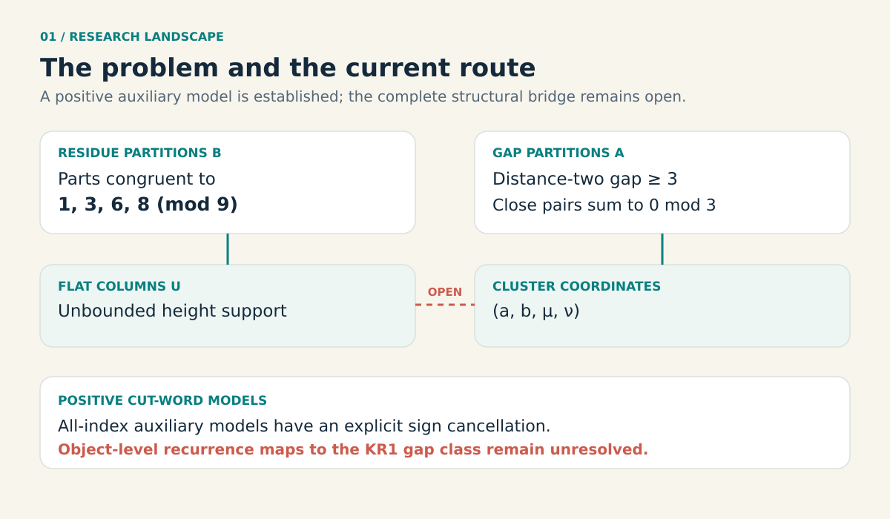
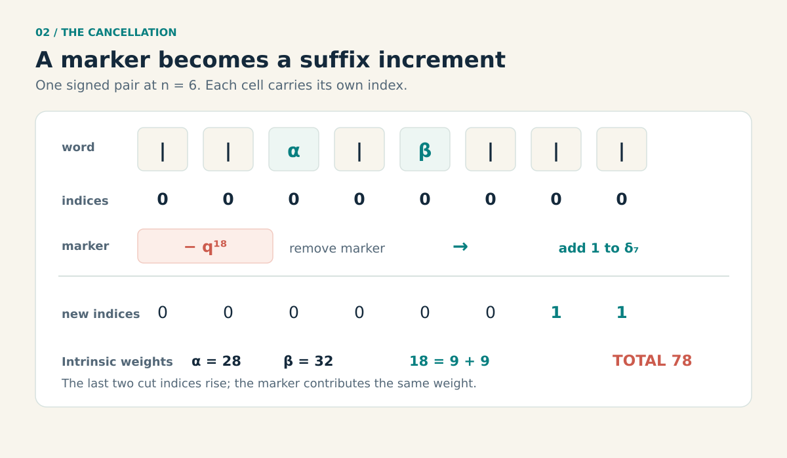
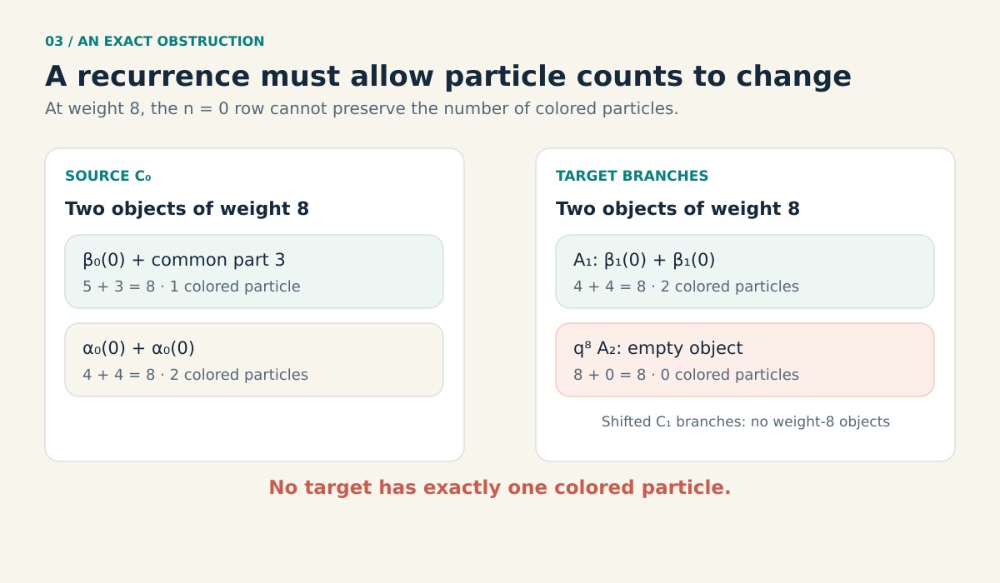

# A staircase inside a partition problem

**Excerpt:** A search for a Kanade–Russell bijection led us to a family of positive formulas built from colored words, cuts, and a small cancellation rule. The full bijection remains out of reach, but the construction gives a concrete way to see positivity in a larger class of divided differences.

*By Christopher Yamba | Autodidactic Math Traveler*

The aim of this project is to turn one kind of integer partition into another, preserving the sum at every step. We have not yet found that complete transformation. Along the way, however, we found a positive combinatorial model for a family of expressions that appears in a recent analytic approach to the problem. The model also works in a more general setting.

The result is this: for the paired nodes and normalization described below, a normalized divided difference is the generating function of an explicit set of colored words. Every object in that set has a nonnegative integer weight. The proof takes a signed expansion, pairs its positive and negative objects by a reversible rule, and identifies the unpaired objects directly. An independent mathematical review supports the argument, subject to the cited divided-difference expansion. We have not established whether this formulation is new.

That is progress toward the partition problem. It is not the requested bijection. The missing step is still to construct mutually inverse, weight-preserving maps from these positive word models to the relevant gap-restricted partitions.

*Flat columns and cluster coordinates offer another representation of the partition problem. The positive cut-word models describe auxiliary sequences; the bridge remains open.*

## Two ways to partition a number

A partition writes a nonnegative integer as a sum of positive integers, with order ignored. For example, the partitions of 4 include \(4\), \(3+1\), and \(1+1+1+1\).

The first Kanade–Russell identity, often called **KR1**, compares two partition families:

- On the product side, every part is congruent to \(1\), \(3\), \(6\), or \(8\) modulo \(9\). Repetition is allowed.
- On the gap side, parts at distance two differ by at least \(3\). Whenever adjacent parts differ by at most \(1\), their sum must be divisible by \(3\).

For instance, \(1+1\) is allowed on the product side. It is not allowed on the gap side, because the two adjacent parts sum to \(2\). The gap-side partition of weight 2 is \(2\). A bijection would send every product-side partition to exactly one gap-side partition of the same weight, with an explicit inverse for every output.

In September 2026, Ernest Xia posted a preprint claiming analytic proofs of all five modulo-nine Kanade–Russell sum-product identities. Independently, Yuma Mizuno posted a preprint on the three symmetric identities. A [Palomar registry entry](https://palomar-registry.org/entry?id=PALOMAR-2026-09-10-000002&version=1) reports Lean and independent nanoda kernel checks for a formalization of those three sum-product identities. We inspected the pinned KR1 statement and the solution wrapper, though we did not build or independently trace the external development. The registry's statement comparison was AI-mediated, not human peer review. These results concern the sum-product identities; they do not supply the structural partition bijection sought here. [Xia's preprint](https://arxiv.org/html/2609.08816v1) is the starting point for our construction.

## Why look at divided differences?

Xia compares sequences of generating functions through recurrences. On the product side, the construction uses **divided differences**, a way to compare values of a function at several nodes. The lowest-order example is familiar:

$$
f[x,y]=\frac{f(x)-f(y)}{x-y}.
$$

Higher divided differences compare more nodes. They can contain subtractions, so a formula for one does not automatically reveal the objects counted by its coefficients. Xia's Lemma 2.2 supplies a useful expansion in terms of ordered cuts and colored particles. The expansion is positive before a particular normalizing factor is introduced; after normalization, signs appear.

The useful question became: can the signs be canceled by a rule on the objects themselves?

## The positive word theorem

Here is a concise version of the result. Let \(c,d\) be positive integers, let \(0<r_i<c\) for \(i=0,\ldots,n\), and take distinct nodes

$$
z_i=q^{r_i}+q^{c-r_i}.
$$

Define

$$
\Phi_{d,c}(z)=\prod_{j\geq0}\frac{1}{1-zq^{dj}+q^{c+2dj}}.
$$

For every \(0\leq m\leq n\), the normalized divided difference

$$
(q^d;q^d)_m\,\Phi_{d,c}[z_0,\ldots,z_n]
$$

is the generating function of an explicit positive colored-word model. The notation \((q^d;q^d)_m\) means \(\prod_{h=1}^m(1-q^{dh})\). There is also a version with an extra factor \((1-q^{r_0})\), obtained by forbidding one particle at one position.

The condition \(m\leq n\) matters to the construction: it guarantees that the needed gap positions exist in every word. It also cannot simply be dropped in the general statement. With \(n=0\), \(m=1\), \(d=1\), \(c=5\), and \(r_0=2\), the coefficient of \(q\) in the normalized expression is \(-1\).

The theorem uses Xia's cut expansion as an input. The passage from that expansion to the positive word model is the construction explained below. It does not assume the KR1 sum-product identity.

## From cuts to words

Imagine a row of particles in two colors, \(\alpha\) and \(\beta\), separated into layers by \(n\) cuts. A particle also has a nonnegative integer index. Each cut has an index, and the particles in a layer must lie between its neighboring cuts. The endpoints are inclusive, so particles in neighboring layers can share an index. Their layer and color labels keep them distinct.

Flatten the object into a word: list the first layer's particles, write a cut, list the second layer, and continue. Within each layer, sort particles by index, putting \(\alpha\) before \(\beta\) when their indices tie. The resulting indices are weakly increasing.

There is just one local wrinkle. If a \(\beta\) is immediately followed by an \(\alpha\) in the same layer, the second index must be strictly larger. Otherwise the tie-breaking convention would have put \(\alpha\) first. A cut between the letters separates layers and removes that particular restriction.

Now subtract these forced rises from the successive index differences. What remains is a sequence of nonnegative gaps, which we call \(\delta_1,\ldots,\delta_N\), where \(N\) is the number of symbols in the word, cuts included. Given the word and gaps, we recover all the original indices by adding the forced rises back. Nothing has been lost.

The \(t\)-th gap shifts every index from position \(t\) onward. Its weight is therefore

$$
d(N-t+1)\,\delta_t.
$$

Reading from the end of the word, the final gap has weight \(d\), the one before it has weight \(2d\), and so on. That staircase of weights is exactly what the normalizing product needs.

*In this six-cut example, removing a weight-18 marker raises two cut indices, adding 9 to each. Both signed partners have weight 78.*

## The cancellation, one marker at a time

Expand \(\prod_{h=1}^{m}(1-q^{dh})\) using a set of markers. Marker \(h\), when present, has weight \(dh\) and changes the sign. The gap \(\delta_{N-h+1}\) has the same unit weight \(dh\).

Choose the smallest \(h\) for which either the marker is present or its matching gap is positive. If the marker is present, remove it and increase the gap by one. If the marker is absent and the gap is positive, insert the marker and decrease the gap by one. The weight stays the same, and the sign changes.

Apply the rule again and the same \(h\) is selected, so the second move reverses the first. The unpaired objects are exactly those with no markers and with their final \(m\) gaps equal to zero. These survivors are the positive word model.

For a concrete example, take \(d=9\), six cuts, and \(m=2\). The markers have weights 9 and 18. In the word consisting only of six cuts, the last two gaps have unit weights 9 and 18. An object with the weight-18 marker and all gaps zero pairs with an unmarked object whose 18-weight gap is one. In the latter object, the six cut indices are \((0,0,0,0,1,1)\), so their total index charge is also 18. The paired objects contribute opposite signs at the same weight.

This is a finite cancellation at each weight, not a list of equal-sized sets paired by rank. The rule tells us what to change and how to undo it.

## What the model says about KR1

Special choices of the nodes give positive models for Xia's auxiliary sequences \(A_n\) and \(C_n\); a shifted disjoint union gives \(B_n\). In the \(A_n\) case, the extra factor mentioned above forbids the first layer's \(\alpha\) particle at index zero. There is a particularly simple way to express that restriction in a flattened word: if the first symbol is \(\alpha\), its index must be positive.

There is also an explicit positive series. Each word contributes a fixed weight from its particle types and forced rises, multiplied by a product of geometric factors for its unlocked gaps. The [research manuscript](https://github.com/cyamba/yamba-ai-math/tree/main/research/rogers-ramanujan/terra2026) states the formula and its proof for general nodes, including the empty-word case.

The challenge is to make the recurrence itself combinatorial. One of its rows has the form

$$
C_n=A_{n+1}+q^{3n+3}C_{n+1}
+q^{6n+6}C_{n+1}+q^{6n+8}A_{n+2}.
$$

A complete construction would decide, from each \(C_n\) word, which branch it belongs to, transform it into the corresponding object, and recover the original word uniquely. Matching generating functions does not tell us how to do that.

*At weight 8, the positive word models force a change in particle count across any complete recurrence bijection.*

The smallest cases already tell us that the operation must do more than move cuts around. At \(n=0\) and weight 8, one \(C_0\) object consists of a single colored particle of weight 5 and a common part of weight 3. There is no one-particle object of weight 8 anywhere in the four branches on the right. In particular, the \(q^8A_2\) branch contributes its empty object. Thus any full recurrence bijection must sometimes change the number of colored particles. A rotation or boundary transfer that always preserves particle count cannot be the whole answer.

## Other pieces of the search

One auxiliary local surgery does have explicit forward and inverse rules: it replaces multiplicities of three kinds of parts by one of two marked branches while preserving two separate formal degrees. Its residue specializations preserve ordinary partition weight. This is a local tool, not a map for all KR1 partitions.

We also found a limitation on approaches that keep part sizes too close together. Even after restricting the product side to a finite choice of multiplicities at each allowed part, a counting argument rules out every injection into the gap side whose largest output part is bounded by \(\alpha\) times the largest input part plus a constant, for every \(\alpha<\log(256)/\log(159)\), about \(1.094\). The argument uses a finite-state encoding of the gap conditions. It leaves room for constructions with unbounded carry or global movement.

These are different kinds of progress. The positive model is a general theorem with a written proof; the two observations constrain possible constructions. None is a complete residue-to-gap algorithm.

## What was checked

*The checks support specific components of the construction; the complete KR1 bijection remains an open construction problem in this work.*

The word-model argument received an independent source-based mathematical review. Our Lean development checks the generic sign-toggle mechanism, including its involution, weight preservation, sign change, and fixed-point condition. Other Lean components check selected block, matrix, and inequality statements. Lean does **not** yet formalize the source divided-difference expansion, the complete word encoding, or a KR1 bijection.

As a transcription check, a script exercised 124,944 finite word, gap, and marker states. A separate coefficient comparison checked 18 \(A_n\) and \(C_n\) cases for \(n=0,\ldots,8\): 17 cases through weight 45 and \(A_1\) through weight 30, for 813 coefficients in total, with no mismatches. The \(A_0\) entry was computed from its separately defined product. These calculations are useful checks; they do not replace a proof for all weights.

## Where to go next

The next step is to find a reversible operation on the positive words that realizes the recurrence's branches. It must account for particle creation or removal, changing cut positions, the periodic change in the common-part tail, and the locked gaps at the end of each word. It must also identify its branch from the output, so that the inverse has no choices to guess.

That is the part of the journey still ahead. The staircase gives us a clearer place to stand: a signed analytic expression has become a collection of explicit positive objects. The question now is how those objects travel.

## Research credits

Christopher Yamba supplied the research direction, mathematical ideas, and intuition. GPT-6.1 Terra mathematical agents developed constructions and reviewed arguments using the yamba-ai-math research harness and its role guidance. The coordinating session used GPT-6 Astra Pro. These credits describe the collaboration and do not attribute every proof to Christopher.

## References and research record

- Ernest X. W. Xia, [*The modulo 9 Kanade–Russell identities and their Nahm-sum duals*, arXiv:2609.08816v1](https://arxiv.org/html/2609.08816v1), especially Lemma 2.2 and equations (3.5)–(3.7).
- Yuma Mizuno, [*The three Kanade–Russell identities modulo nine*](https://arxiv.org/abs/2609.09653), and the [Palomar formalization record](https://palomar-registry.org/entry?id=PALOMAR-2026-09-10-000002&version=1).
- Shane Chern and Zhitai Li, [*Linked partition ideals and Kanade–Russell conjectures*](https://arxiv.org/abs/1809.08655), for the linked-ideal framework behind the finite-state gap model.
- Ali Uncu and Wadim Zudilin, [*Reflecting (on) the modulo 9 Kanade–Russell identities*](https://arxiv.org/abs/2106.02959), for finite forms and pair/singleton constructions.
- [Research manuscript, proofs, reviews, and reproducible checks](https://github.com/cyamba/yamba-ai-math/tree/main/research/rogers-ramanujan/terra2026).
