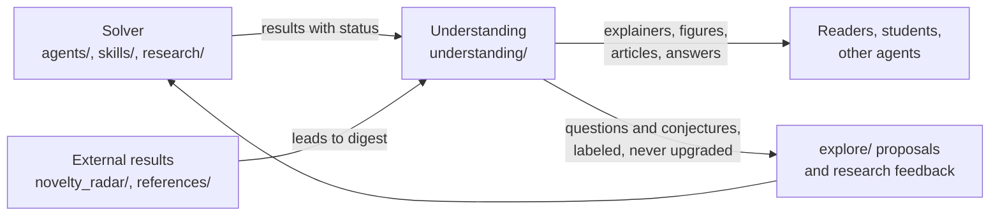

# Understanding layer

**Make the mathematics understandable, usable and generative.** The solver side of this
repository (`agents/`, `skills/`, `research/`) produces and checks results. This layer turns
results into intuition, pictures, verified examples, step-by-step explanations, applications,
answers and written exposition, for people and for other agents. Done well, understanding feeds
back: new intuitions suggest new questions, and those questions return to the solver as
labeled conjectures.

## What is here

| Path | Purpose |
| --- | --- |
| [SKILL.md](SKILL.md) | Entry skill `understand-math`: non-negotiables, workflow chooser, routing |
| [AGENTS.md](AGENTS.md) | Local rules for any agent working in this folder |
| [skills/](skills/) | Nine workflows: build-intuition, visualize-math, step-by-step, abstraction-levels, forge-examples, apply-theorem, answer-question, write-exposition, digest-result |
| [references/levels.md](references/levels.md) | The ladder of abstraction and rigor, audience profiles and paths |
| [references/styles.md](references/styles.md) | Exposition styles and when to use each |
| [references/quality-checklist.md](references/quality-checklist.md) | Checks before anything leaves this folder |
| [templates/](templates/) | Explainer and worked-example templates |
| `explainers/` | Durable outputs, one folder per topic, created on first use |

## How agents use it

| Agent | How to invoke |
| --- | --- |
| Claude Code | `/understand-math` (linked from `.claude/skills/understand-math`) |
| Codex | `$understand-math` (linked from `.agents/skills/understand-math`) |
| Any other agent | Read [SKILL.md](SKILL.md), then the one workflow it points to; `AGENTS.md` routes here |
| The research harness | Not routed yet: packets include only `skills/<name>/SKILL.md` by capability (`harness/runtime.py`). Adding an exposition capability is a framework change; propose it under [meta/](../meta/README.md) first |

The links are symbolic links to this folder, so there is one copy of every instruction.

## Typical uses

- Digest a new result from a research run, an AI-generated manuscript or a formalization before
  building on it.
- Write an explainer, a blog post, lecture notes or a textbook-style chapter with examples,
  figures and exercises.
- Answer a question at the right level, or explain one result at several levels for a mixed
  audience.
- Show how and where a theorem applies, with its hypotheses checked and its misuses named.
- Produce faithful figures: Young diagrams, bijection traces, coefficient tables, proof maps.

## Relation to the framework explainer

[.agents/skills/understanding](../.agents/skills/understanding/SKILL.md) explains the
framework itself: tutorials, diagrams of the harness, walkthroughs of programs and packets.
This folder explains the mathematics.
